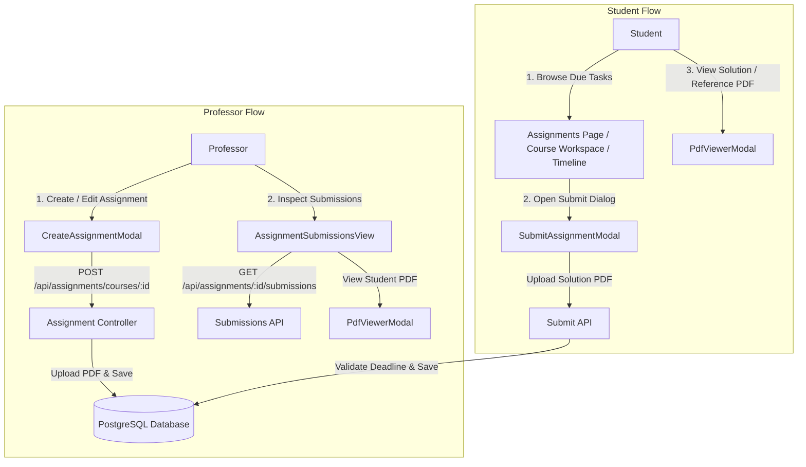

# EduFlow – Assignment & Assignment Submission System Documentation

## 1. Overview & Architecture

The **Assignment Management System** in EduFlow provides an end-to-end workflow for professors to author, schedule, and grade course assignments, while giving students a dedicated submission workspace, document viewer, and timeline tracker.

The feature is fully integrated with PostgreSQL via Prisma ORM, Express.js REST API with JWT authentication, and a Next.js frontend with unified Light/Dark theme support.



---

## 2. Database Design & Prisma Models

The data layer is defined in `backend/prisma/schema.prisma` with two primary models:

### 2.1 `Assignment` Model
Represents an assignment created by a professor for a specific course.

```prisma
model Assignment {
  id                  String                 @id @default(uuid())
  courseId            String
  professorId         String
  title               String
  description         String
  attachmentPath      String?                // Local path to reference/brief PDF
  attachmentName      String?                // Original filename (e.g. "Homework_1.pdf")
  attachmentSize      Int?                   // Size in bytes
  deadline            DateTime
  status              AssignmentStatus       @default(PUBLISHED)
  allowLateSubmission Boolean                @default(false)
  submissions         AssignmentSubmission[]
  course              Course                 @relation(fields: [courseId], references: [id], onDelete: Cascade)
  professor           User                   @relation("ProfessorAssignments", fields: [professorId], references: [id], onDelete: Cascade)
  createdAt           DateTime               @default(now())
  updatedAt           DateTime               @updatedAt

  @@index([courseId])
  @@index([deadline])
}

enum AssignmentStatus {
  DRAFT
  PUBLISHED
  CLOSED
}
```

### 2.2 `AssignmentSubmission` Model
Tracks a student's submission for a given assignment, enforcing a 1-to-1 relationship per student per assignment with replacement/update capability.

```prisma
model AssignmentSubmission {
  id                String           @id @default(uuid())
  assignmentId      String
  studentId         String
  filePath          String           // Local storage path for student's uploaded solution
  originalFileName  String           // Original client file name
  fileSize          Int?             // Size in bytes
  submittedAt       DateTime         @default(now())
  updatedAt         DateTime         @updatedAt
  status            SubmissionStatus @default(SUBMITTED)
  isLate            Boolean          @default(false)
  timingDescription String?          // e.g. "Submitted 2 hours before deadline"
  grade             Float?           // Optional numerical score
  feedback          String?          // Instructor feedback notes
  assignment        Assignment       @relation(fields: [assignmentId], references: [id], onDelete: Cascade)
  student           User             @relation("StudentSubmissions", fields: [studentId], references: [id], onDelete: Cascade)

  @@unique([assignmentId, studentId])
  @@index([assignmentId])
  @@index([studentId])
}

enum SubmissionStatus {
  SUBMITTED
  GRADED
  RESUBMITTED
}
```

---

## 3. Backend Implementation & API Endpoints

All endpoints are registered under `/api/assignments` in `backend/src/routes/assignmentRoutes.ts` with strict role-based authorization via `authenticateToken` and `requireRole`.

### 3.1 Endpoint Summary

| Method | Endpoint | Access | Purpose |
| :--- | :--- | :--- | :--- |
| `GET` | `/api/assignments/timeline` | All Authenticated | Feed of upcoming, submitted, and past assignments sorted chronologically |
| `GET` | `/api/assignments/my-assignments` | Student | List of all assignments across enrolled courses with student's submission status |
| `GET` | `/api/assignments/professor` | Professor / Admin | Overview of all assignments authored by the professor with submission metrics |
| `GET` | `/api/assignments/courses/:courseId` | Enrolled / Author | Course-scoped assignments list |
| `POST` | `/api/assignments/courses/:courseId` | Professor / Admin | Create a new assignment with optional reference document (multipart/form-data) |
| `GET` | `/api/assignments/:assignmentId` | Enrolled / Author | Detailed assignment view |
| `PUT` | `/api/assignments/:assignmentId` | Professor / Admin | Update title, instructions, deadline, status, late policy, or reference PDF |
| `DELETE` | `/api/assignments/:assignmentId` | Professor / Admin | Delete assignment, cascaded file cleanup from filesystem |
| `GET` | `/api/assignments/:assignmentId/submissions` | Professor / Admin | Submission roster, student names, submission timestamps, and grade breakdown |
| `POST` | `/api/assignments/:assignmentId/submit` | Student | Submit solution PDF (multipart/form-data) |
| `GET` | `/api/assignments/:assignmentId/attachment` | Enrolled / Author | Authenticated streaming of assignment reference PDF |
| `GET` | `/api/assignments/submissions/:submissionId/file` | Author / Student | Authenticated streaming of student's submitted solution PDF |

### 3.2 File Storage & Multer Middleware
File uploads are handled by Multer in `backend/src/controllers/assignmentController.ts`:
- Storage path: `uploads/assignments/`
- Allowed MIME types: `application/pdf`, `application/msword`, `application/vnd.openxmlformats-officedocument.wordprocessingml.document`
- Maximum file size: 50MB per upload
- Filename generation: `assignment_<uuid>_<timestamp>_<sanitized_name>`

### 3.3 Deadline & Late Submission Validation
When a student submits via `POST /:assignmentId/submit`:
1. Verifies the user is enrolled in the course.
2. Checks current server time `now` against `assignment.deadline`.
3. If `now > deadline` and `assignment.allowLateSubmission === false`, returns HTTP 400 (`"Assignment deadline has passed and late submissions are not allowed."`).
4. If late submissions are allowed, sets `isLate = true` and records human-readable `timingDescription` (e.g., `"Submitted 3 hours late"`).
5. If the student previously submitted, the old file is safely unlinked from disk and the record is updated (`status: RESUBMITTED`).

---

## 4. Frontend Architecture & Components

### 4.1 Component Tree & File Map

```
frontend/
├── app/dashboard/
│   ├── assignments/page.tsx             # Student: Global assignments list with search & tabs
│   ├── teacher/assignments/page.tsx     # Professor: Global assignments manager with metrics
│   ├── timeline/page.tsx                # Universal: Chronological deadline calendar/timeline
│   └── courses/[courseId]/page.tsx      # Integrated course workspace with Assignments Tab
├── components/
│   ├── CourseAssignmentsTab.tsx         # Course-level assignment workspace tab
│   ├── CreateAssignmentModal.tsx        # Multi-field modal for creating/editing assignments
│   ├── SubmitAssignmentModal.tsx        # Drag-and-drop solution upload modal with late warning
│   ├── AssignmentSubmissionsView.tsx    # Professor submission management roster & stats
│   └── PdfViewerModal.tsx               # In-app secure PDF viewer dialog
└── lib/api.ts                           # Typed API client methods under assignmentApi
```

### 4.2 Key Component Roles

#### `CreateAssignmentModal.tsx`
- Used by professors inside Course Workspace and Global Assignments.
- Prepopulates fields when editing an existing assignment.
- Fields: Title, Detailed Instructions (Textarea), Deadline Date & Time pickers, Allow Late Submissions switch, Optional Reference PDF dropzone.
- Validates that deadline is in the future.

#### `SubmitAssignmentModal.tsx`
- Used by students to submit or resubmit their solution.
- Drag-and-drop file upload with immediate size and `.pdf` type verification.
- Displays dynamic warning badges if the assignment is past deadline but accepts late submissions.

#### `PdfViewerModal.tsx`
- Secure in-app preview for both assignment briefs and student submissions.
- Uses `assignmentApi.fetchAttachmentBlob()` and `assignmentApi.fetchSubmissionBlob()` to stream the file with Bearer token authentication rather than exposing raw public URLs.
- Provides Download and In-Tab Open actions.

#### `AssignmentSubmissionsView.tsx`
- Detailed grading and submission inspection table for professors.
- Summarizes total enrolled students, submitted count, pending count, and late submission flags.
- Directly opens student PDF documents in `PdfViewerModal`.

#### `CourseAssignmentsTab.tsx`
- Embedded directly in `frontend/app/dashboard/courses/[courseId]/page.tsx`.
- Seamlessly adapts based on user role (`PROFESSOR` sees create/edit/delete/submissions actions, `STUDENT` sees submit/resubmit/view briefs actions).

---

## 5. Timing Intelligence & Badge Rules

Both the backend and frontend calculate timing metrics dynamically:

| Condition | Status Badge | Visual Style |
| :--- | :--- | :--- |
| Student submitted before deadline | `Submitted (On Time)` | Emerald Badge (`bg-emerald-500/10 text-emerald-600`) |
| Student submitted after deadline | `Submitted (Late)` | Amber Badge (`bg-amber-500/10 text-amber-600`) |
| Not submitted, deadline > 48h away | `Upcoming` | Indigo / Slate Badge |
| Not submitted, deadline < 48h away | `Due Soon` | Amber Badge with countdown |
| Not submitted, deadline passed (late allowed) | `Overdue (Late Accepted)` | Orange Alert Badge |
| Not submitted, deadline passed (closed) | `Past Due / Closed` | Rose Badge (`bg-rose-500/10 text-rose-600`) |

---

## 6. Theme System Integration

In alignment with EduFlow's centralized design token architecture:
- Every modal backdrop uses `var(--overlay-color)` (`rgba(15, 23, 42, 0.65)` in light, `rgba(0, 0, 0, 0.75)` in dark).
- Card surfaces utilize `var(--bg-card)` and `var(--bg-subtle)`.
- Input fields and textareas dynamically utilize `var(--bg-input)` and high-contrast typography (`var(--text-main)` / `var(--text-secondary)`).
- WebKit date and time picker icons remain legible via CSS filter inversions in both Light and Dark themes.
