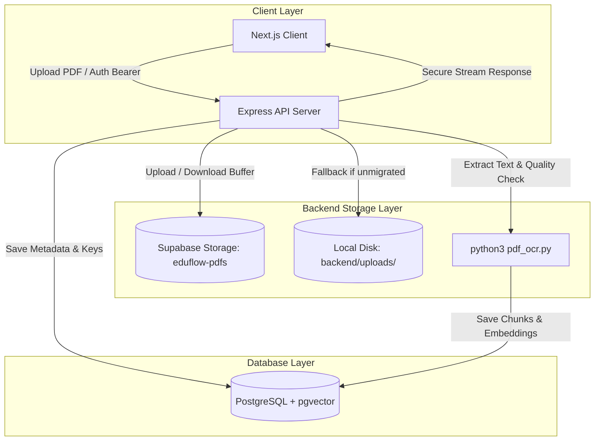

# EduFlow — Supabase Storage Integration & PDF Migration Guide

## 1. Overview & Architecture

EduFlow supports **centralized, secure cloud document storage using Supabase Storage** (Private bucket: `eduflow-pdfs`).
The integration provides a unified storage layer across all three document categories:
1. **Course Materials** uploaded by professors and lecturers.
2. **Assignment Reference Briefs** uploaded by professors when creating tasks.
3. **Assignment Submissions** uploaded by students submitting coursework.



---

## 2. Centralized Storage Service API

Located in [`backend/src/services/supabaseStorageService.ts`](file:///Users/siddharth/iCloud%20Drive%20%28Archive%29%20-%201/Desktop/Desktop%20-%20Siddharth%E2%80%99s%20MacBook%20Air/projects/capston%20project%20/backend/src/services/supabaseStorageService.ts):

| Method | Signature | Purpose |
| :--- | :--- | :--- |
| `uploadPdfToStorage` | `(buffer, storageKey, options) => Promise` | Uploads binary PDF buffer with MIME type and metadata |
| `downloadPdfFromStorage` | `(storageKey, bucket) => Promise` | Downloads binary PDF buffer from Supabase Storage |
| `getSignedPdfUrl` | `(storageKey, expiresInSeconds, bucket) => Promise` | Generates short-lived signed URL for authenticated direct viewing |
| `deletePdfFromStorage` | `(storageKey, bucket) => Promise` | Deletes object from bucket on replacement or deletion |
| `checkStorageFileExists` | `(storageKey, bucket) => Promise<boolean>` | Verifies if an object exists in the bucket |
| `streamPdfToResponse` | `(params) => Promise<boolean>` | Streams PDF to Express `Response`, trying Supabase first, falling back to local disk |

### Standardized Object Key Structure:
- **Materials:** `materials/<courseId>/<timestamp>_<uuid8>_<filename>.pdf`
- **Assignment Attachments:** `assignments/<assignmentId>/attachment_<timestamp>_<uuid8>_<filename>.pdf`
- **Student Submissions:** `submissions/<assignmentId>/<studentId>_<timestamp>_<uuid8>_<filename>.pdf`

---

## 3. Database Schema Extensions

In [`backend/prisma/schema.prisma`](file:///Users/siddharth/iCloud%20Drive%20%28Archive%29%20-%201/Desktop/Desktop%20-%20Siddharth%E2%80%99s%20MacBook%20Air/projects/capston%20project%20/backend/prisma/schema.prisma):

- **`Material`**: Added `storageBucket` (default: `"eduflow-pdfs"`) and `storageKey` (`String?`).
- **`Assignment`**: Added `storageBucket` (default: `"eduflow-pdfs"`) and `attachmentKey` (`String?`).
- **`AssignmentSubmission`**: Added `storageBucket` (default: `"eduflow-pdfs"`) and `storageKey` (`String?`).

*Note: Existing `filePath` and `attachmentPath` columns are preserved to maintain 100% backward compatibility and seamless disk fallback.*

---

## 4. Environment Variables

Configure in `backend/.env` (documented in `backend/.env.example`):

```bash
# Supabase Storage Configuration (Private PDF Bucket)
# Project: supabase-amber-lamp
SUPABASE_URL="https://<project-ref>.supabase.co"
SUPABASE_SERVICE_ROLE_KEY="<service-role-secret-key>"
SUPABASE_STORAGE_BUCKET="eduflow-pdfs"
```

> **Security Rule:** `SUPABASE_SERVICE_ROLE_KEY` is strictly confined to the backend. It is never exposed in client bundles or frontend environment files.

---

## 5. Running the PDF Migration Script

The migration utility [`backend/src/scripts/migrateUploadsToSupabase.ts`](file:///Users/siddharth/iCloud%20Drive%20%28Archive%29%20-%201/Desktop/Desktop%20-%20Siddharth%E2%80%99s%20MacBook%20Air/projects/capston%20project%20/backend/src/scripts/migrateUploadsToSupabase.ts) safely syncs existing local PDFs to Supabase Storage with SHA-256 checksum verification.

### Step 1: Run Dry-Run Simulation (No Changes)
```bash
cd backend
npx tsx src/scripts/migrateUploadsToSupabase.ts --dry-run
```

### Step 2: Run Live Migration
```bash
cd backend
npx tsx src/scripts/migrateUploadsToSupabase.ts
```

### Migration Safety Guarantees:
- **Checksum Verified:** Uploaded files are immediately re-downloaded in memory and verified with SHA-256 before updating database rows.
- **Idempotent:** Files already containing a `storageKey` in the database are safely skipped.
- **Zero Local Deletions:** Local disk files are NEVER deleted by the migration script.
- **Size Enforced:** Files exceeding 20 MB are identified and flagged before attempting upload.

---

## 6. Verification & Test Plan

1. **Course Material Upload:**
   - Log in as a Professor -> Course Workspace -> Materials tab -> Upload PDF (< 20 MB).
   - Check console: file uploads to Supabase, OCR extracts pages, status updates to `READY`.
2. **In-Browser PDF Viewer:**
   - Click "View PDF" on any material or assignment attachment.
   - Verify modal opens smoothly and streams document directly.
3. **Student Assignment Submission:**
   - Log in as Student -> Assignments tab -> Submit solution PDF.
   - Verify submission is recorded with timing status (`ON TIME` / `EARLY` / `LATE`).
4. **Resubmission:**
   - Resubmit a solution; confirm old file in Supabase is replaced by the new file.
5. **AI Summaries & AI Tutor:**
   - Open AI Tutor or Summary tab for a course with Supabase-stored materials.
   - Confirm queries and summaries continue working using `DocumentChunk` and pgvector.
6. **Reprocess / Retry:**
   - Trigger Reprocess on a material; verify backend restores document for OCR extraction.
